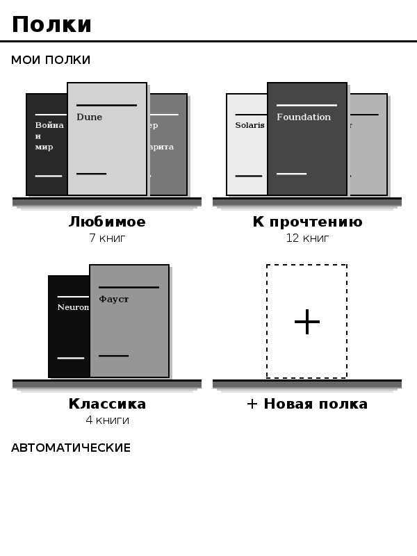
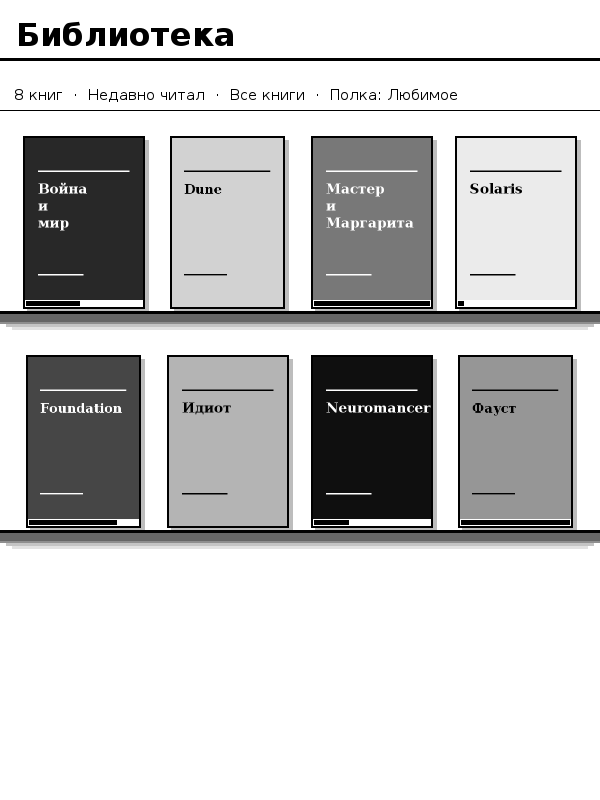

# NookPoint

An e-book reader for the **Nook Simple Touch** (Android 2.1, E Ink) and other old Android devices, inspired by the CrossPoint Reader firmware: calm, minimal, built for E Ink.

*[Читать по-русски](README.ru.md)*

| Shelves screen | Bookcase view |
|---|---|
|  |  |

*Design previews rendered by the app's own drawing code with sample covers.*

## Features

- **Formats:** EPUB 2/3, FB2 and `.fb2.zip`, TXT (UTF-8 or Windows-1251).
- **Typesetting:** bold/italic, headings, lists, quotes, the book's own CSS, justified text, hyphenation with real TeX patterns (Russian, Ukrainian, English, French, Spanish, German, Italian, Portuguese, Bulgarian), widow/orphan control, no stranded prepositions or dashes, pictures with E Ink contrast and full-screen zoom.
- **Reading:** page-turn buttons or edge taps, footnote pop-ups, links with a *Back* stack, bookmarks, highlights with notes (export to text), full-text search, time left in the chapter/book, reading goals and statistics, full refresh every N pages.
- **Library:** list, grid and **bookcase** view with covers and progress, search, sorting, filters, series, **visual shelves**, book information with the annotation.
- **Dictionaries:** StarDict and dictd, huge ones included; long-press a word; saved-words list with export for flash cards.
- **Fonts:** Lora, IBM Plex Serif, DejaVu Serif and Sans built in (Cyrillic and accents), or your own `.ttf` in `fonts/`.
- **Online:** OPDS catalogs (for example your Calibre server), book transfer over Wi-Fi.
- **Safe:** weekly automatic backups, restore, an error log you can send for support.
- **Languages:** English, Русский, Français, Español.

## Install

1. Root the Nook (for example with NookManager).
2. Download `NookPoint-<version>.apk` from [Releases](../../releases) and run `adb install -r NookPoint-<version>.apk`, or copy it to the card and open it with a file manager such as ReLaunch.
3. Put books into `Books/` on the card, or use the **Wi-Fi** button to send them from your phone or computer.

Updating: install the new APK over the old one. Back up first in *Settings → Back up data*.

## Using it

| | |
|---|---|
| Turn pages | page buttons, or tap the left/right edge |
| Menu | tap the middle of the page (or the Menu/centre key) |
| Bookmark | tap the top-right corner |
| Dictionary / highlight | long-press a word |
| Footnote | tap the small number; *Back* returns |
| Picture | tap it for full screen; tap again to zoom, hold to rotate |

**Dictionaries:** put StarDict folders (`.ifo`, `.idx`, `.dict`/`.dict.dz`) or dictd pairs into `dictionaries/` (archives `.zip` and `.tar.gz` are unpacked automatically). *Settings → Dictionaries* shows what was found and why something was skipped.

**Online catalogs:** *Online → Add catalog*, for example `http://192.168.1.10:8080/opds` for a Calibre content server. Android 2.1 handles https poorly, so plain http on your home network works best.

## Build it yourself

No Android SDK needed on your computer: push the project to GitHub and the included workflow (`.github/workflows/build.yml`) builds the APK, signs it and publishes a release with notes.

For updates that always install over the previous version, keep one signing key: run the workflow manually with *show_key* enabled, copy the key text from the run summary into a repository secret named `KEYSTORE_B64`, then delete that run if the repository is public.

## Known limitations

- Tested on the logic level on a computer; behaviour on real devices may differ, so please report problems with the error log (*Settings → Show error log*).
- Pictures inside a line of text are shown as separate blocks; SVG pictures are skipped.
- Secure (https) online catalogs may not work on Android 2.1.

## License

MIT, see [LICENSE](LICENSE). Bundled fonts and hyphenation data have their own licenses: see [THIRD_PARTY_NOTICES.md](THIRD_PARTY_NOTICES.md).
